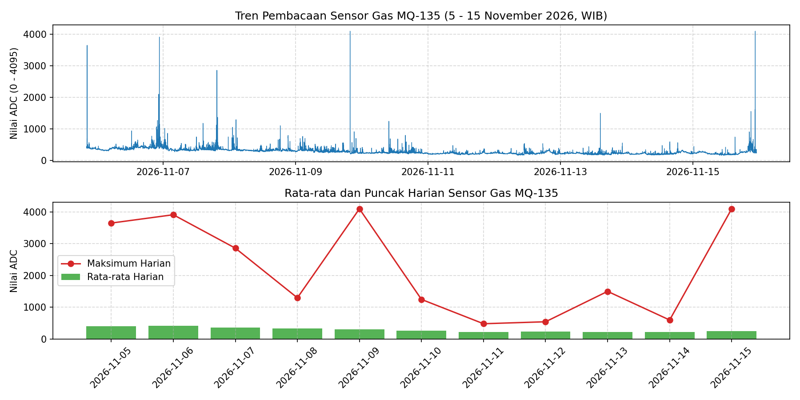

# Sistem Monitoring Kualitas Udara / Gas (MQ-135) Berbasis ESP32 & ThingSpeak

Repositori ini berisi kode sumber *firmware* mikrokontroler ESP32, dataset mentah hasil perekaman sensor selama >7 hari, serta dokumentasi reprodusibilitas untuk sistem pemantauan konsentrasi gas menggunakan sensor **MQ-135** yang dikirimkan melalui protokol **HTTP GET** ke platform cloud **ThingSpeak**.

---

## 📁 Struktur Repositori

* `esp32_mq135_thingspeak.ino` — Kode program utama ESP32 (tanpa kredensial)
* `feeds.csv` — Dataset mentah dari ThingSpeak (28.372 entri, 5–15 Nov 2026)
* `README.md` — Dokumentasi konfigurasi dan cara menjalankan sistem

---

## 🛠️ Spesifikasi Perangkat Keras & Rangkaian Pin

* **Mikrokontroler:** ESP32 DevKit V1 (ESP32 Dev Module)
* **Sensor:** Modul Sensor Gas MQ-135 (Output Analog)

| Pin Sensor MQ-135 | Pin ESP32 | Keterangan |
| :--- | :--- | :--- |
| `VCC` | `VIN` (5V) | Catu daya pemanas (*heater*) sensor MQ-135 |
| `GND` | `GND` | Ground bersama |
| `A0` | `GPIO 34` (ADC1) | Pembacaan sinyal analog (resolusi 12-bit: 0–4095) |

---

## 📦 Dependensi Perangkat Lunak

* **IDE:** Arduino IDE (v1.8.19 atau v2.x)
* **Board Package:** `esp32` by Espressif Systems (v2.0.x atau v3.0.x)
* **Library Bawaan ESP32 (tidak perlu instalasi pihak ketiga):**
  * `WiFi.h` — Manajemen koneksi jaringan nirkabel (IEEE 802.11 / Layer 2).
  * `HTTPClient.h` — Pengiriman permintaan HTTP GET ke REST API ThingSpeak (Layer 7).

---

## 🔒 Konfigurasi Aman

Demi keamanan dan integritas repositori, seluruh informasi sensitif telah dihapus dari kode sumber (`esp32_mq135_thingspeak.ino`) dan diganti dengan *placeholder*. Sebelum mengunggah kode ke ESP32, isi variabel berikut secara lokal pada Arduino IDE:

    const char* ssid = "NAMA_WIFI_ANDA";
    const char* password = "PASSWORD_WIFI_ANDA";
    String apiKey = "WRITE_API_KEY_THINGSPEAK_ANDA";

---

## 🚀 Langkah Menjalankan & Verifikasi

### 1. Menjalankan Firmware pada ESP32
1. Rangkai sensor MQ-135 ke board ESP32 sesuai tabel pin di atas.
2. Buka file `esp32_mq135_thingspeak.ino` di Arduino IDE.
3. Masukkan kredensial WiFi (`ssid`, `password`) dan `Write API Key` channel ThingSpeak Anda.
4. Pilih board **ESP32 Dev Module** dan port COM yang sesuai, lalu klik **Upload**.
5. Buka **Serial Monitor** pada baud rate **115200**.
6. **Hasil Verifikasi:** ESP32 akan terhubung ke WiFi, menampilkan alamat IP lokal, membaca nilai analog ADC setiap **30 detik** (`delay(30000)`), dan mencetak `Kode HTTP: 200` yang menandakan data berhasil masuk ke `Field 1` ThingSpeak.

### 2. Reprodusibilitas Data & Grafik (`feeds.csv`)
1. File `feeds.csv` diunduh langsung dari menu **Data Import / Export** pada channel ThingSpeak.
2. Dataset mencakup **28.372 baris data** (`entry_id` 1 s.d. 28.372) dari tanggal **5 November 2026 pukul 20:14 WIB** hingga **15 November 2026 pukul 22:57 WIB** (durasi >10 hari) dengan interval rata-rata ~30,8 detik dan tanpa nilai kosong (*0 missing values*).
3. Kolom `field1` merepresentasikan nilai me
4.ntah ADC 12-bit (0–4095) yang dapat langsung diolah menggunakan Microsoft Excel, Google Sheets, atau Python (`pandas` & `matplotlib`) untuk menghasilkan kembali statistik harian maupun grafik deret waktu (*time-series*).

## Grafik Hasil Pengukuran
## Grafik & Hasil Analisis Data (`analisis_data.py`)

### Tabel Statistik Harian Sensor MQ-135 (WIB)

Hasil pengolahan 28.372 entri dari `feeds.csv` menggunakan skrip `analisis_data.py`:

| Tanggal (WIB) | Jumlah Data (`count`) | Rata-rata (`mean`) | Median | Minimum (`min`) | Maksimum (`max`) | Standar Deviasi (`std`) |
| :--- | :---: | :---: | :---: | :---: | :---: | :---: |
| 2026-11-05 | 439 | 406,41 | 391,0 | 351 | 3.647 | 165,97 |
| 2026-11-06 | 2.809 | 413,42 | 397,0 | 305 | 3.909 | 138,54 |
| 2026-11-07 | 2.806 | 367,67 | 351,0 | 279 | 2.858 | 81,73 |
| 2026-11-08 | 2.809 | 334,28 | 325,0 | 272 | 1.296 | 54,17 |
| 2026-11-09 | 2.809 | 306,56 | 293,0 | 208 | 4.095 | 93,93 |
| 2026-11-10 | 2.786 | 258,65 | 250,0 | 208 | 1.246 | 41,15 |
| 2026-11-11 | 2.809 | 226,94 | 223,0 | 182 | 481 | 24,53 |
| 2026-11-12 | 2.808 | 240,05 | 233,0 | 166 | 543 | 39,56 |
| 2026-11-13 | 2.807 | 227,10 | 226,0 | 170 | 1.499 | 36,61 |
| 2026-11-14 | 2.806 | 226,90 | 215,0 | 176 | 598 | 35,37 |
| 2026-11-15 | 2.684 | 249,37 | 230,0 | 166 | 4.095 | 110,60 |

### Penjelasan Hasil Pengamatan
- **Kondisi Udara Normal (*Baseline*):** Pembacaan dasar sensor berada di rentang stabil **166 hingga 413,42 ADC** dengan median harian **215,0–397,0 ADC**, menunjukkan kondisi kualitas udara ruangan normal[cite: 6].
- **Lonjakan Sesaat (*Spike*):** Terdeteksi lonjakan hingga batas maksimum ADC **4.095** pada tanggal 9 dan 15 November 2026 (serta 3.647–3.909 pada 5–6 November 2026) akibat paparan gas/asap sesaat sebelum kembali turun ke *baseline*[cite: 6].
- **Stabilitas Pembacaan:** Setelah fase pemanasan awal (*preheating*) pada 5–6 November 2026, nilai standar deviasi harian turun signifikan dari **165,97** menjadi kisaran **24,53–39,56** pada 11–14 November 2026, menandakan sensor bekerja sangat stabil[cite: 6].
